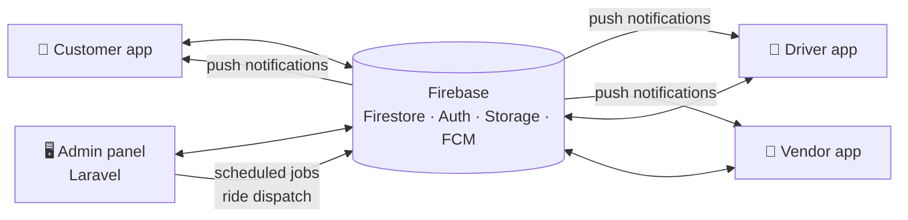

<p align="center"></p>

<h1 align="center">JEOM Mart — Admin Panel</h1>
<p align="center"><b>The web control centre for the whole JEOM Mart platform: rides, orders, drivers, stores, cities, payments and settings.</b></p>

<p align="center">


</p>

<p align="center">Base: eMart <b>V6.8</b> + JEOM Mart customisations</p>

---

## ✨ Features

### 📊 Operations
- Dashboard with live counts for rides, orders, drivers, stores and earnings
- **Live tracking** map of online drivers
- Ride management: city rides, bidding, intercity trips, SOS alerts
- Orders for food, grocery, parcel, rental and on-demand services
- **Assign Driver** directly from the order lists

### 👥 People
- Customers, drivers, fleet owners, vendors, providers and workers
- Driver document verification with auto-approve switch
- Admin users and **role-based permissions**
- **City admins**: each city gets its own scoped panel

### 🏙️ Catalogue & setup
- Sections, zones, vehicle types, car makes / models, rental packages
- Categories, brands, attributes, bulk product import
- Banners, home-page templates, CMS pages, email templates, on-boarding screens

### 💰 Money
- Commission, taxes, delivery charges, coupons, gift cards
- Wallet transactions and payouts for drivers, vendors, owners and providers
- Payment gateway settings (COD, Stripe, PayPal, Razorpay, Paystack and more)
- Subscription plans and advertisements

### ⚙️ Automation
- Artisan commands run every minute by cron (ride dispatch, scheduled rides, notifications)
- Push notifications via Firebase Cloud Messaging
- Multi-language (English / Arabic / Urdu)

## 🧩 The JEOM Mart ecosystem

| Repository | What it is |
|---|---|
| [jeomart-customer-app](https://github.com/Farhan1232/jeomart-customer-app) | Customer app: rides, food, grocery, parcels, rentals, services |
| [jeomart-driver-app](https://github.com/Farhan1232/jeomart-driver-app) | Driver app: ride requests, bidding, deliveries, earnings |
| [jeomart-vendor-app](https://github.com/Farhan1232/jeomart-vendor-app) | Store / restaurant app: menu, orders, staff, payouts |
| [jeomart-admin-panel](https://github.com/Farhan1232/jeomart-admin-panel) | Web admin panel (Laravel) that runs the whole platform |



## 🛠️ Tech stack

| Layer | Technology |
|---|---|
| Framework | Laravel 10 (PHP 8.1+) |
| Main data | Firebase Firestore (read/written from the browser with the Firebase JS SDK) |
| Panel users / roles | MySQL |
| Server-side Firebase | `google/apiclient` with a service account |
| Front end | Blade, jQuery, Bootstrap, DataTables |
| Modules | `nwidart/laravel-modules` (AI module) |

## 📁 Project structure

```
app/
├── Console/Commands/   # cron jobs: ride dispatch, scheduled rides, notifications
├── Http/Controllers/   # one controller per admin section
└── Http/Middleware/    # PermissionMiddleware (route-level permissions)
resources/views/        # Blade pages: rides, orders, drivers, vendors, settings …
routes/web.php
public/                 # JS, CSS, images
Modules/AI/             # AI product helper module
```

## ⚙️ Getting started

### Requirements
PHP 8.1+, Composer, MySQL / MariaDB, Node (only for asset builds), a Firebase project.

### 1. Install
```bash
git clone https://github.com/Farhan1232/jeomart-admin-panel.git
cd jeomart-admin-panel
composer install
cp .env.example .env
php artisan key:generate
```

### 2. Configure `.env`
| Variable | Value |
|---|---|
| `APP_URL` | e.g. `https://your-domain.com/admin` |
| `DB_*` | your MySQL database |
| `FIREBASE_APIKEY`, `FIREBASE_PROJECT_ID`, `FIREBASE_APP_ID`, `FIREBASE_MESSAAGING_SENDER_ID` … | from Firebase console → Project settings → Web app |

### 3. Firebase service account
Download a service-account key from Firebase console → Project settings → Service accounts and save it as:
```
storage/app/firebase/credentials.json      # git-ignored
```

### 4. Database and run
```bash
mysql -u USER -p DB_NAME < database/emart_admin_database.sql   # base tables, roles and permissions
php artisan migrate                                           # JEOM Mart additions (city admins)
php artisan serve
```

### 5. Scheduled jobs
Add one crontab line **per command** (see `app/Console/Commands`), for example:
```
* * * * * cd /path/to/admin && php artisan app:cab-schedule-ride
```
> Do not also add `schedule:run`: the same commands are registered in `Kernel.php`, so they would run twice.

### 6. Google Maps key
Set it in the panel under **Settings → Google Map Key** (stored in Firestore `settings/googleMapKey`, read by the panel and all apps).

## 🔐 Security notes
- `.env`, `storage/app/firebase/credentials.json` and `vendor/` are not in this repository.
- Every project id and key in the code is a placeholder (`your-firebase-project-id`, `YOUR_…`).
- Lock down Firestore security rules before going live.

## 📄 Credits

Built on the **eMart** multi-vendor / multi-service platform, then customised and extended for **JEOM Mart** (Pakistan): ride bidding, intercity trips, city administration, performance work and many fixes.

Maintained by [Farhan](https://github.com/Farhan1232).
